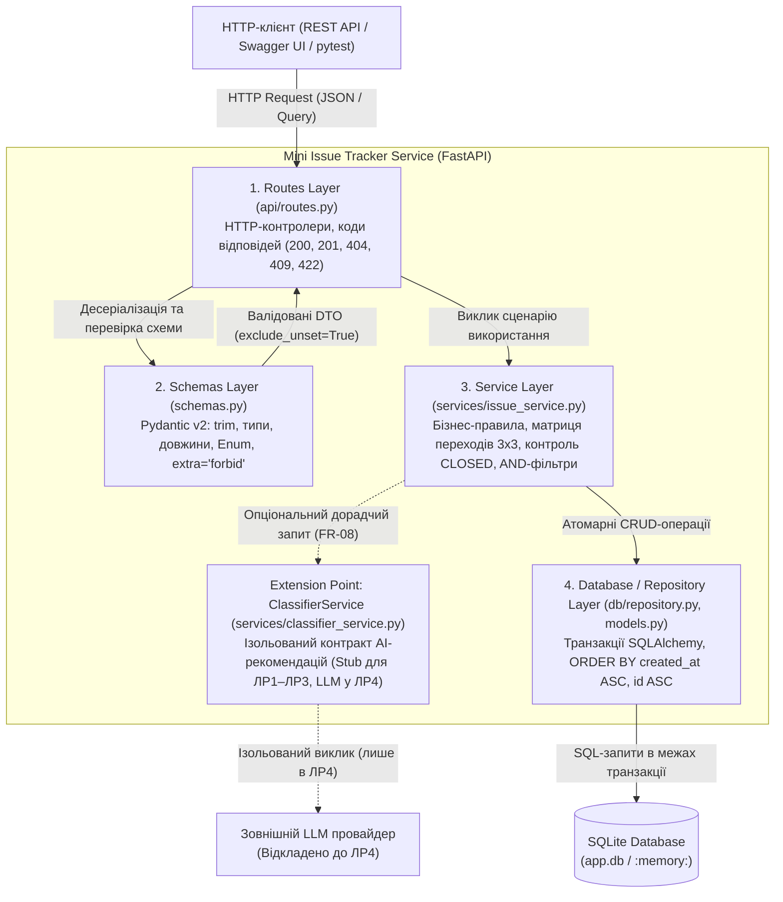
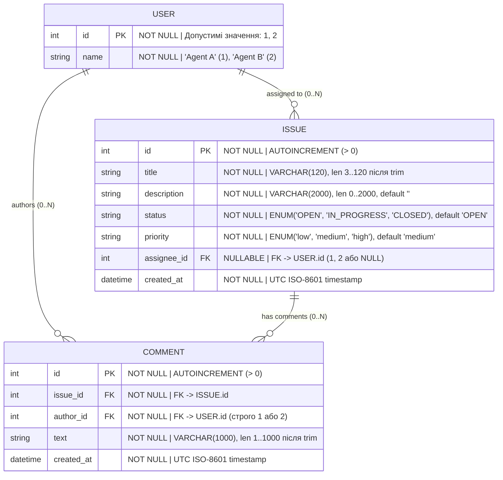

# Mini Issue Tracker — Архітектура системи
**Версія**: 1.0 (APPROVED)  
**Основа**: [docs/requirements.md](requirements.md)  
**Цільовий стек**: Python 3.11+, FastAPI, Pydantic v2, SQLAlchemy / SQLite, pytest  

---

## 1. Схема розподілу відповідальності (C4 Component-Level)

Система спроєктована за принципами багатошарової архітектури (Layered Architecture) із чітким розмежуванням валідації форми входу, доменної бізнес-логіки та інфраструктури збереження даних.

### 1.1. Діаграма компонентів

### 1.2. Опис відповідальності шарів

| Шар (Компонент) | Основна зона відповідальності | Що суворо заборонено в шарі |
| :--- | :--- | :--- |
| **1. Routes (`api/routes.py`)** | Прийом HTTP-запитів, вилучення path/query-параметрів, виклик методів `IssueService`, перетворення доменних винятків (`NotFoundError`, `ConflictError`) у відповідні HTTP-статуси (`404`, `409`) та повернення серіалізованих DTO зі статусами `200 OK` / `201 Created`. | Написання прямих SQL-запитів, перевірка матриці переходів статусів або ручна модифікація полів моделей БД. |
| **2. Schemas (`schemas.py`)** | Декларативна синтаксична та семантична валідація вхідних і вихідних даних засобами Pydantic v2: • Нормалізація рядків (`strip`/`trim`) для `title` та `text` коментаря. • Контроль меж довжин (`title`: 3..120, `description`: 0..2000, `text`: 1..1000). • Перевірка регістрозалежних `Enum` (`status`, `priority`) та фіксованого пулу користувачів `[1, 2]`. • Заборона невідомих полів (`extra = "forbid"`). • Розмежування «ключ не передано» (`exclude_unset=True`) та `null` (дозволено виключно для `assignee_id`). • Відхилення некоректного входу з кодом `422 Unprocessable Entity` до виклику сервісного шару. | Звернення до бази даних, перевірка поточного стану заявки в БД. |
| **3. Service (`services/issue_service.py`)** | Реалізація чистої бізнес-логіки відповідно до [docs/requirements.md](requirements.md): • Перевірка існування заявки перед модифікацією або коментуванням (генерація `404 Not Found`). • Реалізація повної матриці переходів статусів `3 × 3` (`OPEN`, `IN_PROGRESS`, `CLOSED`), включаючи ідемпотентні переходи (`X → X` повертає `200 OK`) та відхилення заборонених (`IN_PROGRESS → OPEN`, `CLOSED → OPEN`, `CLOSED → IN_PROGRESS` повертають `409 Conflict`). • Блокування будь-яких змін через `PATCH /issues/{id}` для заявки у статусі `CLOSED` (`409 Conflict`) при збереженні дозволу на читання та додавання коментарів. • Формування умов фільтрації за `status` та `priority` через логічне `AND`. | Формування HTTP-відповідей, пряма робота з низькорівневими з'єднаннями SQLite поза інтерфейсом репозиторію. |
| **4. Database / Repository (`db/`)** | Абстракція доступу до даних та керування сесіями SQLAlchemy / SQLite: • Забезпечення транзакційної атомарності під час створення та часткового оновлення (`commit` лише за повної успішності або `rollback` при помилці). • Ініціалізація схеми таблиць та передзаповнення (seed) синтетичного довідника користувачів (`1: Agent A`, `2: Agent B`). • Гарантування детермінованого хронологічного сортування вибірок заявок і коментарів: `ORDER BY created_at ASC, id ASC`. • Забезпечення підміни підключення через механізм Dependency Injection (`get_db`) на ізольовану базу (`sqlite:///:memory:`) під час запуску `pytest` (виконання `NFR-02`). | Прийняття бізнес-рішень щодо допустимості переходів статусів або валідація довжини вхідних рядків. |

### 1.3. Точка розширення для AI-класифікатора (`ClassifierService` / Stub)

Для реалізації відкладеної вимоги `FR-08` (автоматична рекомендація категорії, пріоритету та короткого резюме в ЛР4) без порушення вимог автономності (`NFR-04`) у систему закладено ізольований інтерфейс розширення:

* **Інженерний контракт компонента:** `ClassifierService` приймає незмінні текстові дані (`title: str`, `description: str`) та повертає структуру рекомендації `ClassificationSuggestion(category: str, suggested_priority: PriorityEnum, summary: str)`.
* **Поведінка в ЛР1–ЛР3 (`StubClassifierService`):** реалізована як локальна детермінована заглушка (Stub), яка не виконує мережевих викликів і не потребує API-ключів або бібліотек LLM.
* **Межа ізоляції:** `ClassifierService` не має доступу до сесії бази даних (`Repository`) і не може викликати методи зміни `Issue`. Навіть після підключення реальної моделі в ЛР4 згенерована рекомендація має виключно дорадчий (read-only) характер; зміна `priority` у заявці можлива лише через явний виклик `PATCH /issues/{id}` клієнтом.

---

## 2. Модель сутностей (ER-модель)

Реляційна схема даних складається з трьох сутностей: `USER`, `ISSUE` та `COMMENT`. Жодних позапланових таблиць (ролей, сесій, тегів чи історії змін) не створюється.

### 2.1. ER-діаграма (Mermaid)

### 2.2. Правила цілісності та зв'язків
1. **Зв'язок `ISSUE.assignee_id → USER.id`:** необов'язковий зовнішній ключ (`Nullable = True`). Дозволяє створення нерозподілених заявок (`assignee_id IS NULL`) та зняття виконавця під час `PATCH /issues/{id}`.
2. **Зв'язок `COMMENT.issue_id → ISSUE.id`:** обов'язковий зовнішній ключ (`Nullable = False`). Кожен коментар жорстко прив'язаний до існуючої заявки. Оскільки видалення заявок виключено зі scope (`Out of Scope`), каскадне видалення не потрібне.
3. **Зв'язок `COMMENT.author_id → USER.id`:** обов'язковий зовнішній ключ (`Nullable = False`). Анонімні коментарі заборонені.
4. **Індексація та впорядкування:** вибірки з таблиць `ISSUE` та `COMMENT` завжди виконуються з явною умовою сортування `ORDER BY created_at ASC, id ASC`.

---

## 3. Архітектурні рішення (Architecture Decision Records)

### ADR-01: Використання SQLite та локального запуску без контейнерної інфраструктури

* **Статус:** Прийнято (Accepted)
* **Дата:** 01.11.2026
* **Контекст:**  
  Сервіс `Mini Issue Tracker` розробляється для невеликої команди та використовується в межах наскрізного навчального практикуму (ЛР1–ЛР4). Система повинна забезпечувати надійне збереження заявок і коментарів між перезапусками (`FR-07`), підтримувати транзакційну атомарність під час часткового оновлення (`PATCH`), гарантувати миттєвий відтворюваний запуск у локальному середовищі без складного адміністрування (`NFR-01`) та повну ізоляцію тестової бази від робочої (`NFR-02`).
* **Розглянуті варіанти:**
  1. **Клієнт-серверна СУБД PostgreSQL (локально або в Docker-контейнері):** промисловий стандарт із високою конкурентністю запису, але вимагає встановлення Docker/СУБД, запуску фонових процесів, конфігурації мережевих портів і секретів підключення.
  2. **Вбудована реляційна СУБД SQLite (файлова база для роботи + `:memory:` для тестів):** безсерверна транзакційна реляційна база даних, що входить до стандартної бібліотеки Python і підтримується SQLAlchemy.
* **Обране рішення та причини:**  
  Обрано **Варіант 2 — SQLite з локальним запуском через `venv`**.
  * *Відповідність масштабу:* для 2 користувачів та обсягу даних невеликої команди можливостей SQLite більш ніж достатньо.
  * *Нульовий інфраструктурний поріг (`NFR-01`):* проєкт запускається однією командою `uvicorn` без Docker, зовнішніх серверів БД та конфігураційних паролів, які прямо виключені з обсягу проєкту.
  * *Ідеальна тестова ізоляція (`NFR-02`):* SQLite дозволяє запускати інтеграційні тести `pytest` на базі в оперативній пам'яті (`sqlite:///:memory:`), що гарантує високу швидкість тестів і 100% захист робочого файлу `app.db` від модифікації.
  * *Повна підтримка ACID:* забезпечує атомарний відкат (`rollback`) при помилках під час обробки запитів.
* **Наслідки та обмеження:**
  * *Позитивні:* відсутність зовнішніх залежностей при перевірці та захисті роботи; миттєве розгортання на будь-якій ОС; прозорість збереження даних в одному файлі.
  * *Обмеження:* SQLite блокує файл бази даних під час операцій запису, тому не підходить для високонавантаженого конкурентного запису з багатьох вузлів (горизонтального масштабування), що для локального MVP не є вимогою. Завдяки шару `Repository` на базі SQLAlchemy перехід на PostgreSQL у майбутньому за потреби не вимагатиме зміни коду `Service` або `Routes`.

---

### ADR-02: Відокремлення AI-компонента від бізнес-транзакцій та основного життєвого циклу заявок

* **Статус:** Прийнято (Accepted)
* **Дата:** 01.11.2026
* **Контекст:**  
  Згідно з перспективою розвитку продукту (`FR-08`), у ЛР4 система має допомагати визначати категорію, пріоритет і короткий підсумок звернення за допомогою AI. Водночас вимоги `NFR-04` та рішення замовника встановлюють, що базовий облік заявок (`FR-01–FR-07`) має працювати детерміновано та безвідмовно навіть за повної відсутності доступу до LLM, а рекомендація AI не має права змінювати дані заявки без підтвердження людиною.
* **Розглянуті варіанти:**
  1. **Вбудовування виклику LLM безпосередньо в транзакцію створення/редагування заявки (Автозастосування):** під час `POST /issues` сервіс синхронно звертається до LLM і автоматично перезаписує поле `priority` та опис заявки.
  2. **Повна ізоляція AI у виділений консультативний сервіс (`ClassifierService`) без права запису в БД:** основні операції (`POST`, `PATCH`, зміна статусу) працюють виключно за детермінованими правилами, а AI-компонент виступає окремою дорадчою підсистемою (у ЛР1–ЛР3 — через Stub).
* **Обране рішення та причини:**  
  Обрано **Варіант 2 — Ізольований консультативний компонент (`ClassifierService`)**.
  * *Дотримання рішення замовника (`FR-08`):* рекомендація AI не мутує стан заявки автоматично. Остаточне рішення щодо пріоритету чи формулювання завжди залишається за учасником команди через явний виклик `PATCH /issues/{id}`.
  * *Відмовостійкість та автономність (`NFR-04`):* недоступність мережі, вичерпання лімітів токенів, таймаути або галюцинації LLM жодним чином не блокують створення, перегляд, фільтрацію, коментування чи закриття заявок.
  * *Передбачуваність тестування:* тести бізнес-логіки (`FR-01–FR-07`) є на 100% детермінованими і не залежать від імовірнісних відповідей мовної моделі.
* **Наслідки та обмеження:**
  * *Позитивні:* чітка межа відповідальності (Separation of Concerns); збереження високої швидкодії базових CRUD-операцій; можливість розробляти й здавати ЛР1–ЛР3 зі Stub-реалізацією, а в ЛР4 підключити реальну LLM через заміну реалізації `ClassifierService` без переписування `IssueService` та схеми БД.
  * *Обмеження:* для застосування рекомендованого AI пріоритету клієнту (користувачу) необхідно виконати окрему дію підтвердження (виклик `PATCH /issues/{id}`), оскільки система свідомо не змінює дані у фоновому режимі.

